# Organograma do sistema

Este documento mostra a organização proposta para o sistema, distinguindo as
áreas que já existem no frontend das que estão disponíveis apenas como API ou
permanecem planejadas. “Implementado” descreve o código local; não significa que
o ambiente esteja pronto para produção ou piloto.

## Visão geral

```mermaid
flowchart TB
  subgraph People[Usuários e canais]
    SA[SUPER_ADMIN]
    CA[CLINIC_ADMIN]
    AG[AGENT]
    DOC[DOCTOR]
    MAN[MANAGER · previsto]
    PAT[Paciente / contato]
  end

  subgraph Platform[Área da plataforma]
    SPA[Super Admin\nvisão global, clínicas, uso, integrações, jobs e incidentes]
    PA[Autenticação de plataforma separada\nMFA fora do modo local de desenvolvimento]
    SA --> PA --> SPA
  end

  subgraph Clinic[Área da clínica — Next.js]
    HOME[Início]
    CONV[Conversas / Inbox\nlista, chat, contexto, handoff e realtime]
    AGENDA[Agenda\nconsulta semanal · leitura]
    REPORT[Relatórios / Dashboard]
    AISET[Assistente IA\nconfiguração e versões]
    INTEG[Integrações\ncredenciais OpenAI e WhatsApp]
    AUDIT[Auditoria]
    PLAN[Plano e consumo]
    MGMT[Cadastros administrativos\nclínicas, unidades, contatos, pacientes, serviços e profissionais\nAPI existe; faltam telas]
    OPS[Operação avançada\ndisponibilidade, consultas, notificações, SLA e Base de Conhecimento\nAPI existe; faltam telas]
    CA --> HOME
    AG --> HOME
    DOC --> HOME
    MAN --> HOME
    HOME --> CONV
    HOME --> AGENDA
    HOME --> REPORT
    HOME --> AISET
    HOME --> INTEG
    HOME --> AUDIT
    HOME --> PLAN
    HOME -.-> MGMT
    HOME -.-> OPS
  end

  subgraph Core[Backend — NestJS, monólito modular]
    AUTH[Autenticação]
    TENANT[TenantContext + isolamento multi-tenant]
    RBAC[RBAC / permissões]
    API[Controllers e services]
    CONVENG[Conversation Engine]
    TOOLS[Tool Gateway\noperações limitadas e autorizadas]
    KNOW[Knowledge Retriever\nsomente conteúdo publicado]
    SCHED[Serviços de agenda\ndisponibilidade, HOLD e consultas]
    CARE[Clínicas, unidades, contatos, pacientes e catálogo]
    HUMAN[Inbox, handoff e SLA]
    AUDITSVC[Auditoria]
    METRICS[Analytics e planos]
  end

  subgraph Data[Dados e processamento]
    PG[(PostgreSQL + Prisma\nfonte principal de verdade)]
    REDIS[(Redis\nlocks, limites e filas)]
    QUEUE[BullMQ / Worker\nnotificações, retries, cleanup e sincronização]
  end

  subgraph Providers[Provedores externos]
    META[Meta WhatsApp Cloud API]
    OPENAI[OpenAI]
    GOOGLE[Google Calendar\nintegração adiada até validação OAuth real]
  end

  subgraph Flow[Fluxo de atendimento]
    INBOUND[Mensagem recebida]
    STORE[Validar e persistir mensagem]
    ROUTE[Interpretar intenção]
    ANSWER[Resposta informativa / FAQ]
    ACTION[Ação de negócio]
    ESCALATE[Handoff para atendente]
    OUTBOUND[Persistir resposta e enfileirar envio]
    INBOUND --> STORE --> CONVENG --> ROUTE
    ROUTE --> ANSWER
    ROUTE --> ACTION
    ROUTE --> ESCALATE
    ANSWER --> OUTBOUND
    ACTION --> OUTBOUND
    ESCALATE --> CONV
    OUTBOUND --> QUEUE
  end

  Clinic --> AUTH --> TENANT --> RBAC --> API
  API --> CARE
  API --> SCHED
  API --> HUMAN
  API --> AUDITSVC
  API --> METRICS
  API --> PG
  CONV --> CONVENG
  CONVENG --> OPENAI
  CONVENG --> KNOW
  CONVENG --> TOOLS
  TOOLS --> RBAC
  TOOLS --> CARE
  TOOLS --> SCHED
  KNOW --> PG
  SCHED --> PG
  CARE --> PG
  HUMAN --> PG
  AUDITSVC --> PG
  METRICS --> PG
  PAT --> META --> INBOUND
  API --> CONVENG
  QUEUE --> REDIS
  QUEUE --> PG
  QUEUE --> META
  QUEUE -. quando habilitado .-> GOOGLE
  SPA --> PG

  classDef current fill:#e8f5ec,stroke:#16834c,color:#123b27;
  classDef apiOnly fill:#fff5dc,stroke:#bc8619,color:#473711;
  classDef deferred fill:#f1efff,stroke:#7770b6,color:#29244e;
  class HOME,CONV,AGENDA,REPORT,AISET,INTEG,AUDIT,PLAN current;
  class MGMT,OPS apiOnly;
  class MAN,GOOGLE deferred;
```

## Como ler

- **Verde — interface existente:** páginas encontradas em `/`, `/conversations`,
  `/agenda`, `/dashboard`, `/settings/ai`, `/settings/integrations`,
  `/settings/audit`, `/settings/plan` e `/super-admin`.
- **Amarelo — API sem tela administrativa:** operações de cadastro e manutenção
  que já possuem endpoints, mas ainda não estão reunidas em páginas para o usuário.
- **Roxo — previsto ou condicionado:** itens do produto/roadmap que ainda não
  estão prontos para uso normal; o perfil MANAGER está previsto e o Google Calendar
  segue adiado até validação de OAuth e conta real.

## Limites importantes

1. Agenda web é somente leitura; criação, cancelamento e remarcação existem nos
   serviços/API e nos fluxos da IA, mas ainda não em uma tela de calendário
   administrativo.
2. A simulação de WhatsApp na tela de Integrações é visual. A conexão real usa o
   provedor oficial WhatsApp Cloud API e requer credenciais Meta válidas.
3. O modelo recebe contexto informativo e tools limitadas; não recebe acesso direto
   a SQL, Prisma ou ao banco.
4. PostgreSQL é a fonte de verdade. Redis/BullMQ processam coordenação e tarefas
   assíncronas; provedores externos não substituem o estado interno.
5. O menu superior compartilhado está presente na Inbox e na Agenda. Outras páginas
   ainda usam navegação própria ou retorno à página inicial; a experiência visual
   precisa ser unificada.
6. O status de release atual continua condicionado às pendências de staging, CI
   remoto, runtime de produção e backup/recuperação documentadas em
   `docs/release/MVP-FINAL-STATUS.md`.

## Próxima sequência sugerida para as telas

1. Unificar o cabeçalho e a navegação em todas as áreas da clínica.
2. Criar telas de clínicas/unidades, contatos/pacientes e catálogo de serviços e
   profissionais.
3. Criar telas de disponibilidade e gestão de consultas; conectar ações da agenda
   a operações autorizadas da API.
4. Criar gestão de regras de notificação/SLA e da Base de Conhecimento.
5. Completar a validação real das integrações em ambiente de teste antes de exibir
   estados como “conectado”.
